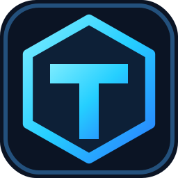

# Tallow



Tallow is a free, open-source 3D game engine and editor for Windows and Linux. Games are written in C# 15 on .NET 11;
the engine and editor are written in [Beef](https://www.beeflang.org). Physics, multiplayer, voxel terrain, a
modeller, shader graphs, visual scripting and a full editor are built in.

- **Download:** [tallowengine.com/downloads](https://tallowengine.com/downloads/) or
  [GitHub Releases](https://github.com/LazyAlgorithm/Tallow/releases). Tallow Manager installs the engine and the
  .NET SDK for you.
- **Documentation:** [tallowengine.com/docs](https://tallowengine.com/docs/), with step-by-step
  [tutorials](https://tallowengine.com/tutorials/).
- **API reference:** [tallowengine.com/api](https://tallowengine.com/api/), rebuilt from this repository on every
  push to `main`.

This repository holds what is needed to build the engine from source.

## Building from source

You need Python 3.11+, CMake 3.20+, Ninja, Git, a C/C++20 compiler, the Beef compiler (`BeefBuild` on `PATH`, or
`BEEFBUILD` set to it) and the .NET 11 SDK. The first CMake configure fetches the pinned Jolt Physics source, so it
needs an internet connection.

**Linux x64.** On Ubuntu 24.04 the system packages are:

```sh
sudo apt-get install build-essential cmake ninja-build python3 git libx11-dev libxext-dev libxi-dev libxfixes-dev \
  libxcursor-dev libxrandr-dev libxss-dev libxrender-dev libgl-dev libegl-dev libasound2-dev libpulse-dev \
  libwayland-dev libxkbcommon-dev
```

A prebuilt Linux Beef compiler, the one Tallow Manager installs, is on the
[v0.1.0-beta release](https://github.com/LazyAlgorithm/Tallow/releases/tag/v0.1.0-beta) (`beef-linux-x64.tar.gz`).
Then:

```sh
git clone https://github.com/LazyAlgorithm/Tallow.git
cd Tallow
./build.sh --config Debug
./build/Debug_Linux64/TallowLauncher/TallowLauncher
```

**Windows x64.** Install Git, Python 3.11+, CMake, Ninja, the Windows Beef compiler, Visual Studio 2022 Build Tools
(Desktop development with C++, with the Windows SDK) and LLVM's `clang-cl`. From an
**x64 Native Tools Command Prompt for VS 2022**:

```bat
git clone https://github.com/LazyAlgorithm/Tallow.git
cd Tallow
python tools\build.py --config Debug
build\Debug_Win64\TallowLauncher\TallowLauncher.exe
```

Windows builds can also be made on Linux after a one-time `tools/windows/setup.sh --accept-license`, and web builds
after `tools/web/setup.sh`.

The build compiles the native libraries, the shaders and the launcher, and collects the third-party licences into
`THIRD_PARTY_LICENSES.txt`. The launcher creates and opens projects:

```text
TallowLauncher --create /path/to/MyGame --showcase   # a new project from the Tallow Gallery template
TallowLauncher --open /path/to/MyGame                # open it in the editor
```

To make a portable editor folder like the release downloads:

```sh
python3 tools/build.py --config Release
python3 tools/package_engine.py --platform linux --folder dist/Tallow-Linux
```

## Layout

```
Engine/       the runtime library, its shaders and assets
Editor/       the editor, the project system and the project templates
Launcher/     the launcher executable (project hub, editor and game runner)
Player/       the precompiled player that built games ship as
Managed/      the C# side: game API, runtime host, build tool and language service
native/       CMake build of the native libraries and Tallow's C/C++ layer
third_party/  vendored dependencies (bgfx, SDL3, JoltC, Recast/Detour, ENet, Dear ImGui, Flecs, Assimp, Opus, ...)
tools/        build, packaging and export scripts
```

## Licence

Tallow is released under the [MIT licence](LICENSE). The libraries it is built on keep their own licences, collected
in [THIRD_PARTY_LICENSES.txt](THIRD_PARTY_LICENSES.txt); built games carry a copy.
